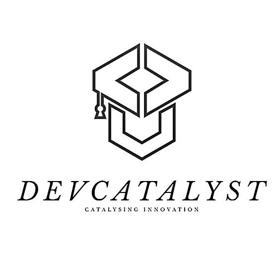

# DevCatalyst Community CRM

<p align="center">
  
</p>

<p align="center">
  <strong>Unified Project Tracking, Event Operations, Recruitment Pipeline & Community Directory for Student Developer Organizations</strong>
</p>

<p align="center">
  <a href="#test-results"></a>
  <a href="#code-quality"></a>
  <a href="#technology-stack"></a>
  <a href="#technology-stack"></a>
  <a href="#technology-stack"></a>
  <a href="#technology-stack"></a>
</p>

---

## Table of Contents

- [Overview](#overview)
- [Key Features](#key-features)
- [UI and Design System](#ui-and-design-system)
- [Technology Stack](#technology-stack)
- [Architecture and Project Structure](#architecture-and-project-structure)
- [Prerequisites](#prerequisites)
- [Installation and Local Development](#installation-and-local-development)
- [Environment Configuration](#environment-configuration)
- [Database Setup and Migrations](#database-setup-and-migrations)
- [Available Scripts](#available-scripts)
- [Testing and Quality Assurance](#testing-and-quality-assurance)
- [Security and Access Control](#security-and-access-control)
- [Staging Deployment Checklist](#staging-deployment-checklist)
- [Implementation Status and Roadmap](#implementation-status-and-roadmap)
- [Contributing](#contributing)
- [License and Acknowledgements](#license-and-acknowledgements)
- [Contact and Community](#contact-and-community)

---

## Overview

**DevCatalyst Community CRM** is a centralized management platform engineered specifically for student developer clubs and technical communities. Technical organizations frequently suffer from fragmented tooling: project tasks exist in one app, event registrations in spreadsheets, member rosters in separate forms, and recruitment evaluations across shared documents.

DevCatalyst Community CRM consolidates these core operations into a unified, secure system:

1. **Public Discovery Experience:** A public homepage showcasing active initiatives, upcoming community events, transparent membership guidelines, and an open application portal.
2. **Project and Task Tracking:** Multi-project workspace featuring structured project codes (`PRJ-01`), Kanban task boards (`TSK-101`), assignee workflows, and priority tracking.
3. **Event Management and Check-In:** Event creation with automated capacity limits, real-time ticket reservations, SVG QR code passes, and camera-based QR attendance verification.
4. **Recruitment Pipeline:** Structured candidate intake, multi-stage application review, scoring criteria, interview scheduling, and single-click onboarding into the club member directory.
5. **Member Lifecycle CRM:** Member roster with role-based access, contribution metrics, masked contact details for public visitors, and administrative privilege management.
6. **Resilience Architecture:** Dual-mode execution engine that runs seamlessly offline using an in-memory mock engine or connects directly to a live PostgreSQL backend powered by InsForge.

---

## Key Features

### Implemented Functionality

#### Public Discovery & Engagement
- **Public Homepage (`/`):** Club overview, live statistics counters, featured initiatives, upcoming events, and call-to-action sections.
- **Public Application Portal (`/apply`):** Streamlined candidate application form with instant reference code issuance for submission tracking.
- **Public Member Directory (`/members`):** Searchable member cards with role badges and automated phone number masking (`***-***-1234`) for unauthenticated visitors.
- **Public Event Catalog (`/events` & `/events/:id`):** Event schedules, venue details, speaker profiles, live capacity gauges, and instant ticket registration.

#### Project & Kanban Management (`/projects`, `/tasks`)
- **Initiatives Hub:** Project creation, status tracking (`PLANNING`, `ACTIVE`, `COMPLETED`, `ON_HOLD`), and task progress percentage indicators.
- **Interactive Kanban Boards (`/projects/:id/board`):** Categorized task columns (`TODO`, `IN_PROGRESS`, `REVIEW`, `DONE`) with priority badges (`LOW`, `MEDIUM`, `HIGH`, `URGENT`) and due dates.
- **My Tasks View (`/tasks`):** Filterable, centralized dashboard showing all tasks assigned to the authenticated user across projects.
- **Sequential Code Generation:** Safe code generation for projects (`PRJ-01`) and project-scoped tasks (`TSK-101`).

#### Event Operations & QR Attendance (`/events`, `/registrations`)
- **Atomic Capacity Reservation:** Stored procedures prevent overselling during high-concurrency event registration bursts.
- **Digital QR Tickets:** Client-side dynamic QR code generation containing signed registration ticket tokens.
- **Scanner Modal & Check-in Verification:** Scanner interface enabling event organizers to validate tickets and record attendance in real time.
- **Calendar Pass Export:** Generation of standard `.ics` calendar files for easy export into Google Calendar, Outlook, and Apple Calendar.

#### Recruitment Pipeline & Candidate Review (`/recruitment`)
- **Stage Progression:** Visual recruitment pipeline managing applicants across stages (`APPLIED` → `SCREENING` → `INTERVIEW_SCHEDULED` → `INTERVIEWED` → `OFFER_EXTENDED` → `ACCEPTED` / `REJECTED`).
- **Standardized Scorecards:** Evaluator scorecards with quantitative criteria ratings (Technical Skills, Communication, Collaboration) and private notes.
- **Interview Scheduler:** Modal to schedule interview dates, meeting links, and interviewer assignments.
- **Atomic Onboarding Procedure:** Transition candidate records directly into active `profiles` and assign initial club member roles.

#### Analytics, Reports & Settings (`/reports`, `/settings`)
- **Club Intelligence Dashboard (`/reports`):** Metric widgets calculating active member counts, event capacity utilization, ticket attendance conversion rates, and project task completion rates.
- **Security Audit Log:** Immutable audit logging for role promotions, candidate stage shifts, and administrative modifications.
- **System Diagnostics:** Schema verification panel in `/settings` to inspect connected database connectivity and migration status.
- **Idempotent Administrator Bootstrapping:** Database procedure `bootstrap_initial_admin(email)` ensuring secure, one-time initial administrator assignment.

### Incomplete or Planned Capabilities

To provide an accurate technical assessment, the following items are currently simulated or planned for subsequent releases:

- **Direct SMTP Delivery:** The application currently logs transactional notifications (ticket confirmations, interview invitations) through a mock webhook delivery provider (`notificationProvider.ts`). Live transactional email requires connecting an external SMTP/webhook service.
- **Direct Resume File Uploads:** Candidates currently submit external links (Google Drive, GitHub, LinkedIn, portfolio). Direct binary file upload to object storage (S3/InsForge storage bucket) is planned.
- **Real-Time WebSockets:** Kanban board updates currently synchronize via polling and query refreshes. Live collaborative subscriptions via WebSocket channels are scheduled for a future milestone.

---

## UI and Design System

The user interface follows the **Brand-Aligned Editorial Monochrome** design specification defined in [`design-system/devcatalyst-hub/MASTER.md`](design-system/devcatalyst-hub/MASTER.md).

- **Foundational Surfaces:** Deep primary black (`#090909`) for structural navigation and headers; crisp white (`#FFFFFF`) and neutral light gray (`#FAFAFA`) for content cards and canvases.
- **Semantic Status Hierarchy:** Preserved semantic accents for high-clarity status recognition:
  - `Emerald` (`#ECFDF5` / `#047857`): Done tasks, confirmed registrations, attended tickets, accepted candidates.
  - `Blue` (`#EFF6FF` / `#1D4ED8`): Active projects, tasks in progress, candidate screening.
  - `Amber` (`#FFFBEB` / `#B45309`): Medium priority, capacity thresholds nearing limits.
  - `Red` (`#FEF2F2` / `#B91C1C`): Urgent tasks, closed registrations, rejected applicants.
- **Typography:** **Inter** for UI layouts, labels, and forms; **JetBrains Mono** for IDs (`PRJ-01`, `TSK-102`), ticket codes, and timestamps.
- **Density Tier:** High-density dashboard layouts (`4px` grid increments) designed for administrative efficiency and data clarity.

> *Note: Screen captures can be added to this section once visual assets are captured from a running deployment.*

---

## Technology Stack

| Category | Technology | Version | Purpose |
| :--- | :--- | :--- | :--- |
| **Frontend Framework** | [React](https://react.dev/) | `^19.3.1` | Declarative component UI engine |
| **Language** | [TypeScript](https://www.typescriptlang.org/) | `~6.0.3` | End-to-end static typing and interface contracts |
| **Build & Dev Tooling** | [Vite](https://vite.dev/) | `^8.3.4` | Ultra-fast local development and production bundler |
| **Styling & CSS** | [Tailwind CSS](https://tailwindcss.com/) | `^4.3.3` | Utility-first styling with `@tailwindcss/vite` integration |
| **Routing** | [React Router](https://reactrouter.com/) | `^7.18.4` | Client-side routing, layout nesting, and protected route guards |
| **Icons & Media** | [Lucide React](https://lucide.dev/) | `^1.60.0` | Accessible SVG icon suite |
| **QR Code Engine** | [qrcode](https://www.npmjs.com/package/qrcode) | `^1.5.4` | Client-side SVG ticket QR code generation |
| **Database & Cloud SDK** | [@insforge/sdk](https://www.npmjs.com/package/@insforge/sdk) | `^1.5.2` | PostgreSQL client with Row-Level Security and Auth |
| **Test Runner** | [Vitest](https://vitest.dev/) | `^5.0.5` | Fast unit and integration test runner |
| **Testing Utilities** | [React Testing Library](https://testing-library.com/) | `^16.3.3` | Component interaction and DOM assertion helpers |
| **DOM Environment** | [jsdom](https://github.com/jsdom/jsdom) | `^30.1.3` | In-memory DOM simulation for Vitest suites |
| **Static Linter** | [Oxlint](https://oxc.rs/docs/guide/usage/linter.html) | `^1.88.0` | High-performance Rust-based static code analyzer |

---

## Architecture and Project Structure

### Dual-Mode Architecture

The application implements a resilient execution pattern in [`src/lib/insforge.ts`](src/lib/insforge.ts):

```
                     ┌──────────────────────────────────┐
                     │         React Application        │
                     │  (Pages, Components, Contexts)   │
                     └─────────────────┬────────────────┘
                                       │
                         [ Environment Inspection ]
                                       │
              ┌────────────────────────┴────────────────────────┐
              ▼                                                 ▼
   [ VITE_INSFORGE_URL Unset ]                       [ VITE_INSFORGE_URL Set ]
   Local Development Mode                            Production / Staging Mode
              │                                                 │
              ▼                                                 ▼
   ┌───────────────────────┐                         ┌───────────────────────┐
   │ In-Memory Mock Engine │                         │   InsForge Cloud SDK  │
   │ Pre-seeded Demo Data  │                         │ PostgreSQL Database   │
   │ (Zero Setup Required) │                         │ Row-Level Security    │
   └───────────────────────┘                         └───────────────────────┘
```

1. **Development Mode (`import.meta.env.DEV`):** When connection parameters are not specified, the application automatically engages an in-memory mock engine with pre-seeded users, projects, tasks, candidates, and events.
2. **Production Mode (`import.meta.env.PROD`):** The application strictly requires valid backend connection parameters. Missing credentials trigger an explicit configuration alert rather than silently falling back to mock data.

### Directory Structure

```
devcatalyst-projects/
├── .env.example                     # Environment template for cloud connection
├── .gitignore                       # Git ignore definitions (ignores .env, dist, node_modules)
├── .oxlintrc.json                   # Oxlint rules configuration
├── index.html                       # HTML application entry point
├── package.json                     # Project manifest and package scripts
├── package-lock.json                # Deterministic dependency lockfile
├── tsconfig.json                    # Base TypeScript compiler configuration
├── tsconfig.app.json                # Client application TypeScript rules
├── tsconfig.node.json               # Vite and tooling TypeScript rules
├── vite.config.ts                   # Vite bundler, plugins, and test configuration
│
├── design-system/                   # Design token standards and UI specifications
│   └── devcatalyst-hub/
│       ├── MASTER.md                # Global design system rules and color tokens
│       └── pages/                   # Dedicated page UI guidelines
│           ├── administration.md
│           ├── dashboard.md
│           ├── events.md
│           ├── kanban.md
│           ├── members.md
│           ├── projects.md
│           ├── recruitment.md
│           ├── registrations.md
│           └── reports.md
│
├── migrations/                      # PostgreSQL database migrations
│   ├── 001_initial_schema.sql       # Profiles, roles, projects, tasks tables
│   ├── 002_row_level_security.sql   # RLS policies and has_role() helper
│   ├── 003_bootstrap_admin.sql      # Idempotent admin bootstrapping procedure
│   ├── 004_project_code_and_permissions.sql # Code generators and role restrictions
│   ├── 005_events_and_registrations.sql     # Events, tickets, capacity checks
│   ├── 006_recruitment_and_members.sql      # Recruitment pipeline and onboarding
│   ├── 007_security_hardening.sql   # Function search_path and phone masking view
│   ├── 008_public_projects_and_discovery.sql# Public project visibility
│   ├── 009_notifications_and_automation.sql # Notification delivery tracking
│   └── README.md                    # Database migration documentation
│
├── public/                          # Static public assets
│   ├── brand/
│   │   └── devcatalyst-logo.jpg     # Official DevCatalyst emblem
│   ├── favicon.svg                  # Application browser favicon
│   └── icons.svg                    # SVG sprite asset
│
└── src/                             # Application source code
    ├── assets/                      # Bundled illustrations and graphics
    ├── components/                  # Reusable UI component library
    │   ├── attendance/              # QR attendance scanner dialog
    │   ├── auth/                    # Protected route wrapper
    │   ├── common/                  # Primitives (Button, Card, Input, Modal, Badge)
    │   ├── events/                  # Event creation, editing, registration, ticket modals
    │   ├── kanban/                  # Kanban columns and task cards
    │   ├── layout/                  # Navigation bars, headers, sidebars, and layouts
    │   ├── projects/                # Project creation, editing, and member management
    │   ├── recruitment/             # Candidate details, interview scheduler, scorecards
    │   └── tasks/                   # Task creation and editing modal
    ├── contexts/                    # Global React Context providers (AuthContext)
    ├── lib/                         # Core utility libraries (insforge.ts)
    ├── pages/                       # Route view components
    │   ├── auth/                    # Login, Register, Forgot Password
    │   ├── dashboard/               # Main workspace overview
    │   ├── events/                  # Event listings and detail views
    │   ├── home/                    # Public landing page
    │   ├── members/                 # Public and internal member directories
    │   ├── profile/                 # User profile settings
    │   ├── projects/                # Project catalog, details, Kanban board
    │   ├── recruitment/             # Candidate pipeline and public apply form
    │   ├── registrations/           # Event attendee administration
    │   ├── reports/                 # Metric dashboards and analytics
    │   └── settings/                # Platform settings and administration
    ├── services/                    # Business logic and data access services
    │   ├── analyticsService.ts
    │   ├── attendanceService.ts
    │   ├── authService.ts
    │   ├── eventService.ts
    │   ├── memberService.ts
    │   ├── notificationProvider.ts
    │   ├── notificationService.ts
    │   ├── notificationTemplates.ts
    │   ├── profileService.ts
    │   ├── projectService.ts
    │   ├── recruitmentService.ts
    │   ├── registrationService.ts
    │   └── taskService.ts
    ├── test/                        # Vitest test suites (13 suites, 167 tests)
    │   ├── auth.test.tsx
    │   ├── dashboard.test.tsx
    │   ├── events.test.ts
    │   ├── notifications.test.ts
    │   ├── profile.test.ts
    │   ├── projects.test.tsx
    │   ├── public_home.test.tsx
    │   ├── recruitment.test.ts
    │   ├── reports.test.tsx
    │   ├── routes.test.tsx
    │   ├── security_matrix.test.ts
    │   ├── settings.test.tsx
    │   ├── setup.ts
    │   └── tasks.test.tsx
    ├── types/                       # TypeScript interfaces and schema types
    │   ├── auth.ts
    │   ├── database.ts
    │   └── notifications.ts
    ├── utils/                       # Utility helpers (calendar export)
    ├── App.tsx                      # Root component and route routing tree
    ├── index.css                    # Tailwind CSS v4 styling rules
    └── main.tsx                     # Application entry point
```

---

## Prerequisites

Ensure the following tools are installed on your environment before running the project:

- **Node.js:** `v20.x` or higher (tested on Node.js 20+)
- **npm:** `v10.x` or higher
- **Git:** `v2.40.x` or higher
- **PostgreSQL Client (Optional):** `psql` or the InsForge CLI (`@insforge/cli`) if connecting a live PostgreSQL database.

---

## Installation and Local Development

Follow these steps to run DevCatalyst Community CRM locally on your machine:

### 1. Clone the Repository

```powershell
git clone https://github.com/chvnagarjunababu14-boop/devcatalyst-community-crm.git
cd devcatalyst-community-crm
```

### 2. Install Project Dependencies

```powershell
npm install
```

### 3. Start the Development Server

The application is fully runnable immediately without configuring a database. By default, it operates using the built-in development mock engine:

```powershell
npm run dev
```

The application will be accessible at:
👉 **`http://localhost:5173/`**

### Pre-Seeded Local Accounts (Development Mode Only)

When operating with the in-memory mock engine, log in with any of the following accounts:

| Email | Password | Assigned Roles | Access Level |
| :--- | :--- | :--- | :--- |
| `admin@devcatalyst.club` | `password123` | `ADMIN`, `ORGANIZER` | Full system access, member management, project deletion |
| `sarah.lead@devcatalyst.club` | `password123` | `PROJECT_LEAD`, `MEMBER` | Project editing, task assignment, candidate reviews |
| `marcus.member@devcatalyst.club` | `password123` | `MEMBER` | Assigned task updates, event registrations |

---

## Environment Configuration

Environment variables are managed using Vite's configuration system. An example file is provided in [`.env.example`](.env.example).

To connect to a live cloud database or custom endpoint, create a local environment file:

```powershell
Copy-Item .env.example .env.local
```

### Environment Variables Reference

| Variable | Description | Required | Exposed to Browser | Example Format |
| :--- | :--- | :---: | :---: | :--- |
| `VITE_INSFORGE_URL` | InsForge backend endpoint URL | Optional for dev, Required for cloud | Yes (`VITE_` prefix) | `https://your-project.insforge.app` |
| `VITE_INSFORGE_ANON_KEY` | Public anonymous API key (governed by PostgreSQL RLS) | Optional for dev, Required for cloud | Yes (`VITE_` prefix) | `eyJhbGciOi...` |
| `VITE_APP_NAME` | Display name of the platform | No | Yes | `DevCatalyst Community CRM` |
| `VITE_APP_ENV` | Application environment target | No | Yes | `development` \| `staging` \| `production` |

> [!WARNING]
> **Client-Side Secret Protection**: Never add database administrative credentials, `service_role` keys, or SMTP passwords into `.env.local` or any variable prefixed with `VITE_`. All `VITE_` variables are bundled directly into client-side JavaScript and are publicly readable. Database access is strictly secured via PostgreSQL Row-Level Security (RLS) policies.

---

## Database Setup and Migrations

The project uses PostgreSQL with Row-Level Security (RLS) managed through InsForge.

### Migration Sequence

Database schema changes are stored in the [`migrations/`](migrations/) directory and must be executed in numerical order:

| File | Purpose |
| :--- | :--- |
| [`migrations/001_initial_schema.sql`](migrations/001_initial_schema.sql) | Defines foundational tables: `profiles`, `user_roles`, `projects`, `project_members`, and `tasks`. |
| [`migrations/002_row_level_security.sql`](migrations/002_row_level_security.sql) | Enables RLS across all tables, creates `public.has_role()` helper, and configures baseline policies. |
| [`migrations/003_bootstrap_admin.sql`](migrations/003_bootstrap_admin.sql) | Implements the idempotent `bootstrap_initial_admin(email)` procedure. |
| [`migrations/004_project_code_and_permissions.sql`](migrations/004_project_code_and_permissions.sql) | Sets up sequential code generators and restricts `VIEWER` task editing. |
| [`migrations/005_events_and_registrations.sql`](migrations/005_events_and_registrations.sql) | Configures `events`, `registrations`, `attendance`, atomic RSVP RPC, and ticket validation. |
| [`migrations/006_recruitment_and_members.sql`](migrations/006_recruitment_and_members.sql) | Sets up `recruitment_cycles`, `applications`, `application_interviews`, scorecards, and onboarding RPC. |
| [`migrations/007_security_hardening.sql`](migrations/007_security_hardening.sql) | Closes search-path hijacking risks on `SECURITY DEFINER` functions and establishes `member_directory_view` with masked phone numbers. |
| [`migrations/008_public_projects_and_discovery.sql`](migrations/008_public_projects_and_discovery.sql) | Adds `is_public` flag and public read policies for community initiatives. |
| [`migrations/009_notifications_and_automation.sql`](migrations/009_notifications_and_automation.sql) | Configures the `notifications` table, idempotency tracking, and delivery attempt states. |

### Applying Migrations

#### Option 1: Via InsForge CLI
```powershell
npx @insforge/cli link
npx @insforge/cli db query (Get-Content migrations/001_initial_schema.sql -Raw)
npx @insforge/cli db query (Get-Content migrations/002_row_level_security.sql -Raw)
npx @insforge/cli db query (Get-Content migrations/003_bootstrap_admin.sql -Raw)
npx @insforge/cli db query (Get-Content migrations/004_project_code_and_permissions.sql -Raw)
npx @insforge/cli db query (Get-Content migrations/005_events_and_registrations.sql -Raw)
npx @insforge/cli db query (Get-Content migrations/006_recruitment_and_members.sql -Raw)
npx @insforge/cli db query (Get-Content migrations/007_security_hardening.sql -Raw)
npx @insforge/cli db query (Get-Content migrations/008_public_projects_and_discovery.sql -Raw)
npx @insforge/cli db query (Get-Content migrations/009_notifications_and_automation.sql -Raw)
```

#### Option 2: Via PostgreSQL `psql`
```bash
psql "$DATABASE_URL" -f migrations/001_initial_schema.sql
psql "$DATABASE_URL" -f migrations/002_row_level_security.sql
psql "$DATABASE_URL" -f migrations/003_bootstrap_admin.sql
psql "$DATABASE_URL" -f migrations/004_project_code_and_permissions.sql
psql "$DATABASE_URL" -f migrations/005_events_and_registrations.sql
psql "$DATABASE_URL" -f migrations/006_recruitment_and_members.sql
psql "$DATABASE_URL" -f migrations/007_security_hardening.sql
psql "$DATABASE_URL" -f migrations/008_public_projects_and_discovery.sql
psql "$DATABASE_URL" -f migrations/009_notifications_and_automation.sql
```

### Initial Administrator Bootstrapping

To prevent arbitrary privilege escalation during registration:
1. Register a standard user via the UI (`http://localhost:5173/register`) using the administrator's email address (e.g. `admin@devcatalyst.club`).
2. Execute the bootstrapping function directly in the database:
   ```sql
   SELECT public.bootstrap_initial_admin('admin@devcatalyst.club');
   ```
3. **Safety Protection:** This procedure will fail if an administrator already exists in the database. Subsequent role modifications must be performed by an existing `ADMIN` via the Member CRM.

---

## Available Scripts

The following scripts are defined in [`package.json`](package.json):

| Script | Command | Purpose | When to Use |
| :--- | :--- | :--- | :--- |
| `npm run dev` | `vite` | Starts local development server with Hot Module Replacement (HMR) | During active feature development and UI testing |
| `npm run build` | `tsc -b && vite build` | Type-checks code with `tsc` and compiles optimized production bundle into `dist/` | Prior to staging promotion and deployment |
| `npm run test` | `vitest run` | Executes all 13 test suites and outputs test execution results | Before committing changes and during CI/CD checks |
| `npm run lint` | `oxlint` | Runs fast static analysis across all TypeScript and React files | Code review and static quality verification |
| `npm run preview`| `vite preview` | Serves the compiled `dist/` directory locally | Inspecting the production build before deployment |

---

## Testing and Quality Assurance

The application maintains a comprehensive automated testing suite written with Vitest and React Testing Library.

### Test Results

The test suite consists of **167 tests across 13 test suites**, achieving a 100% pass rate:

```
Test Files  13 passed (13)
     Tests  167 passed (167)
```

| Test File | Tests | Focus Area |
| :--- | :---: | :--- |
| [`src/test/security_matrix.test.ts`](src/test/security_matrix.test.ts) | 29 | 7-Persona RBAC matrix and least-privilege permission validation |
| [`src/test/recruitment.test.ts`](src/test/recruitment.test.ts) | 25 | Candidate pipeline transitions, scorecards, and onboarding |
| [`src/test/events.test.ts`](src/test/events.test.ts) | 24 | Event capacity rules, ticket issuance, and QR check-in flows |
| [`src/test/notifications.test.ts`](src/test/notifications.test.ts) | 22 | Email/event notification templates, idempotency, and retries |
| [`src/test/tasks.test.tsx`](src/test/tasks.test.tsx) | 11 | Kanban task status transitions, assignments, and deletion rules |
| [`src/test/public_home.test.tsx`](src/test/public_home.test.tsx) | 10 | Public discovery landing page, public forms, navigation links |
| [`src/test/projects.test.tsx`](src/test/projects.test.tsx) | 10 | Project creation, editing, task counts, and member assignments |
| [`src/test/settings.test.tsx`](src/test/settings.test.tsx) | 9 | Platform settings, diagnostics, and schema checks |
| [`src/test/reports.test.tsx`](src/test/reports.test.tsx) | 8 | Analytics metric calculations and chart rendering |
| [`src/test/auth.test.tsx`](src/test/auth.test.tsx) | 7 | User login, session management, and role loading |
| [`src/test/dashboard.test.tsx`](src/test/dashboard.test.tsx) | 6 | Dashboard metric cards, refresh flows, and error handling |
| [`src/test/profile.test.ts`](src/test/profile.test.ts) | 3 | Profile fetching and metadata updates |
| [`src/test/routes.test.tsx`](src/test/routes.test.tsx) | 3 | Route protection, unauthorized redirects, and layout guards |

### Running Tests Locally

```powershell
# Run all tests once
npm run test

# Run tests in watch mode
npx vitest

# Run a specific test suite
npx vitest src/test/security_matrix.test.ts
```

### Code Quality

Static analysis is performed using [Oxlint](https://oxc.rs/):

```powershell
npm run lint
```

Current status: **0 errors** across 83 files with 116 linting rules.

---

## Security and Access Control

DevCatalyst Community CRM implements strict multi-layer access controls:

### 1. Role-Based Access Control (RBAC) Matrix

The system validates operations against a 7-persona authorization matrix:

| Action / Scope | Anonymous | Member | Contributor | Viewer | Project Lead | Organizer | Administrator |
| :--- | :---: | :---: | :---: | :---: | :---: | :---: | :---: |
| Browse Public Home & Events | Yes | Yes | Yes | Yes | Yes | Yes | Yes |
| Submit Candidate Application | Yes | Yes | Yes | Yes | Yes | Yes | Yes |
| View Assigned Tasks | No | Yes | Yes | Yes | Yes | Yes | Yes |
| Update Assigned Task Status | No | Yes | Yes | No | Yes | Yes | Yes |
| Create / Edit Projects | No | No | No | No | Yes | Yes | Yes |
| Manage Project Members | No | No | No | No | Yes | No | Yes |
| Review Applications & Scorecards | No | No | No | No | Yes | Yes | Yes |
| Scan QR Tickets & Verify Attendance | No | No | No | No | No | Yes | Yes |
| System Settings & Schema Checks | No | No | No | No | No | Yes | Yes |
| Assign Administrative Roles | No | No | No | No | No | No | Yes |

### 2. Database Protection & Hardening
- **PostgreSQL Row-Level Security (RLS):** Every table enforces RLS. Anonymous client requests can only read public data (e.g. published events, public initiatives).
- **Search-Path Hijacking Protection:** All `SECURITY DEFINER` stored procedures in [`migrations/007_security_hardening.sql`](migrations/007_security_hardening.sql) explicitly set `SET search_path = public, pg_temp` to prevent search path poisoning.
- **Privacy Masking:** The `public.member_directory_view` masks phone numbers for unauthenticated visitors while permitting verified club organizers and administrators to view contact information.
- **Controlled Ingestion:** Direct insertion into `applications` is restricted; all applications must proceed through the validated `submit_recruitment_application` stored procedure.

---

## Staging Deployment Checklist

Before deploying this application to a staging or production cloud environment:

- [ ] **Environment Variables:** Configure `VITE_INSFORGE_URL` and `VITE_INSFORGE_ANON_KEY` in the hosting environment.
- [ ] **Verify Database Connection:** Ensure the target InsForge project is accessible and active.
- [ ] **Execute Migrations:** Apply migrations `001` through `009` in strict numerical sequence.
- [ ] **Bootstrap Admin:** Register the administrative account and run `SELECT public.bootstrap_initial_admin('admin@yourdomain.com');`.
- [ ] **Verify Quality Gates:** Run `npm run test` and `npm run build` in the deployment pipeline (0 failures required).
- [ ] **Test Ticket Scan:** Validate that ticket QR codes can be generated and successfully checked in via the scanner modal.
- [ ] **Test Public Application:** Confirm that `/apply` produces a unique reference code without leaking reviewer scorecards.

---

## Implementation Status and Roadmap

### Current Status
- **Phase 1-8:** Complete (Foundation Schema, RLS, Kanban, Event Operations, Recruitment CRM, Analytics, Administration, Public Discovery, and Notifications Auditing).
- **Test Coverage:** 167 automated unit and integration tests passing.
- **Code Quality:** Zero Oxlint errors.

### Proposed Roadmap

The following enhancements are proposed for future development:

- [ ] **Phase 9:** Direct S3 / InsForge storage bucket integration for binary resume file uploads and event banner media.
- [ ] **Phase 10:** External transactional email dispatching via Resend or SendGrid webhook integration.
- [ ] **Phase 11:** Bi-directional Google Calendar API synchronization for scheduled interviews and club workshops.
- [ ] **Phase 12:** Real-time collaborative Kanban updates powered by PostgreSQL CDC / WebSocket channels.
- [ ] **Phase 13:** Automated Discord and Slack bot webhooks for recruitment notifications and event reminders.

---

## Contributing

Contributions from the DevCatalyst community are welcome. To contribute:

1. **Fork the Repository:** Create your own fork of `devcatalyst-community-crm`.
2. **Create a Feature Branch:**
   ```powershell
   git checkout -b feature/your-feature-name
   ```
3. **Make Your Changes:** Follow the project's TypeScript conventions and monochrome design token rules.
4. **Run Verification Commands:**
   ```powershell
   npm run lint
   npm run test
   npm run build
   ```
5. **Commit Your Changes:**
   ```powershell
   git commit -m "Add feature description"
   ```
6. **Push and Open a Pull Request:** Push to your fork and submit a PR to the `main` branch with a description of your changes.

---

## License and Acknowledgements

### License
*No license file is currently present in this repository.* Please consult the DevCatalyst Club leadership regarding terms of use, distribution, or contribution.

### Acknowledgements
- [Lucide Icons](https://lucide.dev/) for the UI icon set.
- [Vite](https://vite.dev/) and [React](https://react.dev/) for frontend development tooling.
- [Tailwind CSS](https://tailwindcss.com/) for utility styling.
- [InsForge](https://insforge.com/) for PostgreSQL cloud infrastructure and SDK.

---

## Contact and Community

- **Repository:** [https://github.com/chvnagarjunababu14-boop/devcatalyst-community-crm](https://github.com/chvnagarjunababu14-boop/devcatalyst-community-crm)
- **Issue Tracker:** [https://github.com/chvnagarjunababu14-boop/devcatalyst-community-crm/issues](https://github.com/chvnagarjunababu14-boop/devcatalyst-community-crm/issues)
- **Organization:** DevCatalyst Student Developer Club
